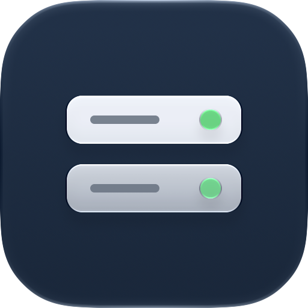
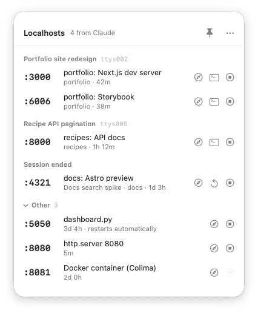
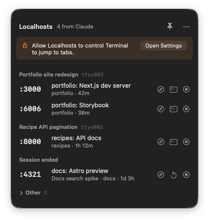
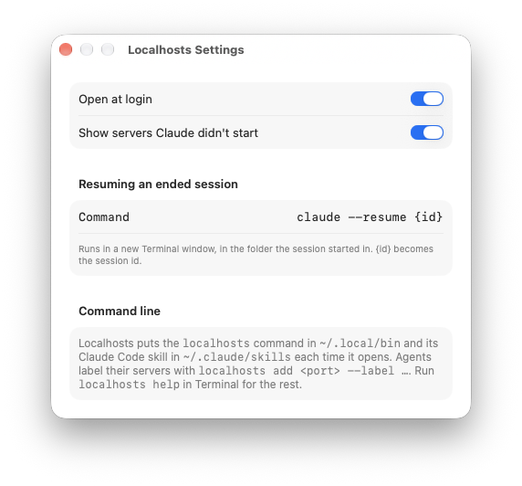
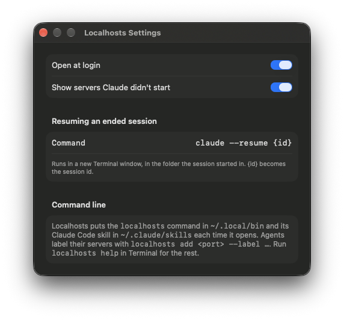
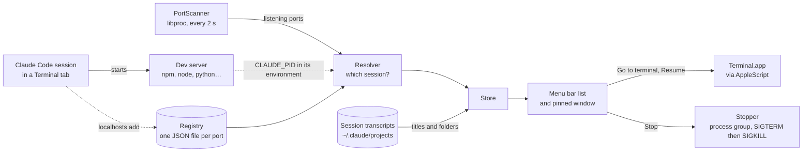

# Localhosts

A small Mac menu bar app that lists the servers your Claude Code agents start on localhost, grouped by the session that started them. One click opens a server, stops it, or takes you to the Terminal tab of the agent that's running it.

Agents start a lot of dev servers. After a busy afternoon you can have five Next.js previews, a Storybook and a Python server running, with no idea which Terminal tab owns which, and `lsof` won't tell you. Localhosts watches for anything listening on a port, works out which Claude session started it, and puts it all in one list.

<picture>
  <source media="(prefers-color-scheme: dark)" srcset="docs/screenshots/panel-dark.png">
  
</picture>

*Servers grouped by the Claude session that started them. The screenshots use demo data.*

## Features

- Every server your agents start shows up on its own, under the session's title and Terminal tab
- **Open** the server in your browser
- **Go to the Claude terminal** brings the agent's Terminal tab to the front
- **Resume** an ended session in a new Terminal window, in the folder it ran in
- **Stop** ends the whole server, not just the process holding the port: npm, node and any workers it started
- Servers Claude didn't start go in a collapsed "Other" section; macOS services and apps from `/Applications` stay hidden
- Pin the list to the desktop as a small floating window, or keep it in the menu bar
- A `localhosts` command, so agents can check what's already running before they start another copy
- A Claude Code skill that tells agents to use it
- Marks servers that launchd restarts, and won't stop a Docker port that would take every container down with it

## Installing

Download the latest `.dmg` from [Releases](https://github.com/LBSiUK/Localhosts/releases), open it and drag Localhosts into Applications. Then open it from Applications.

The builds aren't notarised yet, so the first time you open it macOS will say it can't check it for malware. Try to open it once, then go to System Settings → Privacy & Security, scroll down and click Open Anyway. You only need to do this once.

Each time it opens from Applications, Localhosts:

- links the `localhosts` command into `~/.local/bin` (add that folder to your `PATH` if it isn't already)
- copies its Claude Code skill to `~/.claude/skills/localhosts`, if you use Claude Code
- turns on Open at Login the first time (you can turn it off in Settings)

It has no Dock icon. Look for the server rack in the menu bar. If your menu bar is full, macOS may tuck the icon behind the » overflow. Opening Localhosts again from Applications or Spotlight brings up its window, or you can ⌘-drag the icon somewhere visible.

### Terminal permission

The first time you press **Go to the Claude terminal** or **Resume**, macOS asks whether Localhosts may control Terminal. Click Allow. If you said no, the app shows a banner with a button that opens the right page in System Settings:



## Using it

Each row shows the port, a label and, underneath, the folder and how long it has been running. Point at a row to see the full command, process ID and address.

| Button | What it does |
| --- | --- |
| Open (compass) | Opens `http://localhost:<port>` in your browser, or the page the agent registered |
| Go to the Claude terminal | Selects the Terminal tab running that Claude session and brings its window forward |
| Resume (arrow) | For a session that has ended: runs `claude --resume <id>` in a new Terminal window, in the session's folder |
| Stop | Sends the server's processes SIGTERM, then SIGKILL after 3 seconds for anything still running |

The sections are:

- **One section per running Claude session**, titled with the session's name and its Terminal tab (`ttys005`).
- **Session ended** for servers whose Claude session has closed. They keep running, and Resume picks the conversation up again.
- **Other** for everything else listening on a port: your own scripts, Docker, launchd jobs. It starts collapsed and you can hide it in Settings.

The pin button in the header puts the same list in a small floating window that stays on top, follows you across Spaces and grows and shrinks with the list. Drag it anywhere; it remembers where you left it. Click the pin again to put it away.

| | |
| --- | --- |
|  |  |
| *Settings in light mode.* | *And in dark mode.* |

In Settings you can change the command Resume runs. `{id}` becomes the session ID, so `claude --dangerously-skip-permissions --resume {id}` works if that's how you run Claude.

## The `localhosts` command

The app and the command are the same program. Agents use it, and so can you:

```
localhosts list [--json]         every server, with the Claude session that owns it
localhosts add <port|url> [--label TEXT] [--path /page] [--stop-cmd CMD]
                                 label a server you started (waits up to 15 s for it to listen)
localhosts stop <port>           stop a server and the processes it started
```

```
$ localhosts list
PORT   OWNER                 LABEL                             FOLDER
:3000  claude ttys002        portfolio: Next.js dev server     ~/code/portfolio
:4321  claude (ended)        docs: Astro preview               ~/code/docs
:5050  other                 dashboard.py                      ~/ops/dashboard
:6006  claude ttys002        portfolio: Storybook              ~/code/portfolio
:8000  this session          recipes: API docs                 ~/code/recipes
:8080  other                 http.server 8080                  ~/Downloads
```

`this session` marks servers started by the Claude session that ran the command. `--json` gives the same list with process IDs, URLs and session IDs.

`add` is optional. Servers show up without it, labelled with the command that started them (`next dev -p 3101`). It gives a server a readable label, a page to open instead of `/`, or a command to stop it with:

```
localhosts add 3000 --label "portfolio: Next.js dev server"
localhosts add 8000 --label "recipes: API docs" --path /docs
localhosts add 8081 --label "shop: API" --stop-cmd "docker compose stop api"
```

If `localhosts` isn't on your `PATH`, the same commands work as `/Applications/Localhosts.app/Contents/MacOS/Localhosts list`.

### The Claude Code skill

The app installs a skill, [`skill/SKILL.md`](skill/SKILL.md), that Claude Code loads whenever an agent is about to start a server or open a localhost URL. It tells the agent to:

1. run `localhosts list` first, and reuse a server that's already running for the same folder instead of starting a duplicate
2. start servers in the background without clearing the environment, so the app can find its session
3. label the server with `localhosts add` once it's listening, with a stop command for Docker containers
4. stop only throwaway servers it started itself, never another session's

## How it works



- **Finding servers.** Every two seconds `PortScanner` asks the kernel (through libproc, no `lsof`) for every TCP socket in the listening state and the process that owns it. `localhosts list` does a full scan and prints in well under a tenth of a second.
- **Finding the session.** Claude Code puts `CLAUDE_PID` and `CLAUDE_CODE_SESSION_ID` in the environment of every command it runs. `Resolver` reads them from the server process, or from its parents or process group when the server has renamed itself and lost its own environment (Next.js and `npm exec` do this). If that Claude process is still running, the server is live and belongs to its Terminal tab. If not, the session has ended and can be resumed.
- **Names.** Session titles come from the transcripts Claude Code keeps in `~/.claude/projects`. Server labels come from `localhosts add`, or else from a tidied-up version of the command line.
- **Jumping to a tab.** Terminal's AppleScript lists each tab's `tty`. The app selects the tab whose `tty` matches the Claude process and brings its window forward.
- **Stopping.** `Stopper` signals the server's whole process group and the processes under it, so `npm run dev` doesn't leave a worker behind holding the port. It falls back to the server process alone if the group includes Claude itself, an interactive shell, this app or another user's process. Docker ports forwarded by Colima are refused unless the agent registered a stop command, because one process carries every container's ports.

More detail, including what's hidden and why, is in [`docs/design.md`](docs/design.md).

### Privacy

Everything stays on your Mac. The app makes no network requests. It reads process information for your own user, the titles in your Claude Code transcripts, and its own registry in `~/Library/Application Support/Localhosts`.

## Building it yourself

You'll need macOS 26 or later, Xcode 26 or later and [XcodeGen](https://github.com/yonaskolb/XcodeGen). The Xcode project isn't checked in; XcodeGen makes it from `project.yml`.

```
brew install xcodegen
git clone https://github.com/LBSiUK/Localhosts.git
cd Localhosts
./build.sh
```

`build.sh` builds a Release copy, copies it to `/Applications` (replacing any copy already there) and opens it, which installs the command and the skill.

To run the tests:

```
xcodegen generate
xcodebuild -project Localhosts.xcodeproj -scheme Localhosts test
```

Builds are signed to run locally by default. To sign with your own certificate, see the note at the top of `Config/Base.xcconfig`. Sign with the same certificate each time, or macOS will ask for the Terminal permission again after every build. `make-dmg.sh` packages the app as a drag-to-install DMG in `build/`, and can sign and notarise it if you have a Developer ID (the steps are at the top of the script).

Debug builds have a demo mode with made-up servers, used for the screenshots: `Localhosts.app/Contents/MacOS/Localhosts -demo YES`. The options are listed at the top of `Localhosts/App/Demo.swift`.

### Project layout

| Path | What's there |
| --- | --- |
| `Localhosts/App` | App entry point, `Store`, Terminal control, the installer and demo data |
| `Localhosts/Core` | Port scanning, session matching, the registry, stopping and transcript titles |
| `Localhosts/CLI` | The `localhosts` command |
| `Localhosts/Views` | The server list, rows, pinned window and Settings |
| `Localhosts/Resources` | App icon (Icon Composer) and asset catalogue |
| `LocalhostsTests` | Unit tests (Swift Testing), including one that starts, finds and stops a real server |
| `skill/SKILL.md` | The Claude Code skill, bundled into the app |
| `Config/Base.xcconfig` | Signing settings |
| `project.yml` | XcodeGen project definition |
| `build.sh` | Builds a Release copy and installs it to `/Applications` |
| `make-dmg.sh` | Builds the app and packages it as a DMG |
| `docs/` | Design notes and screenshots |

## Status

Early days, but it works. Things to know:

- The builds aren't notarised, so macOS asks you to approve the app the first time (see [Installing](#installing)).
- Go to the Claude terminal works with Terminal.app. Sessions in iTerm, Ghostty or an editor's terminal are still listed, opened, resumed and stopped, but the app can't bring their tab forward.
- It isn't sandboxed, as it needs to see other processes and stop them.
- Not done yet: update checks, and other terminal apps.

## Credits

Copyright © 2026 LBSi UK / Leon Brahams

https://github.com/LBSiUK/Localhosts
